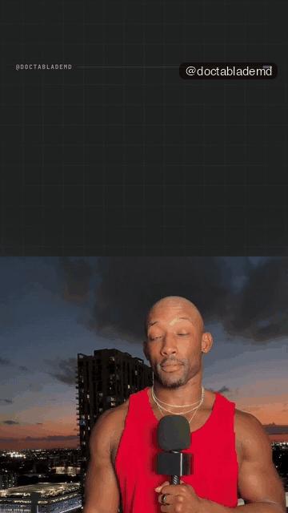

# Reel Room Light (beta)

> **Beta.** It works end to end and is tested on macOS. Expect rough edges; tell the owner what broke (the output of `./reel doctor` helps).

Type `/reel` in Claude Code, give it your talking-head clips, and get a finished 9:16 reel: best takes picked, dead air and false starts cut in real silence, captions that match what you said, graphics that land on the word, and files ready to post (master, share copy, silent version, captions, cover).

This is the **beta Light** version: two looks, the graphics kit and hero moments, no review page. The full version adds six more styles, the Room (a private review page), the vision judge, style scans and repurposing.

## Quick start (about 3 minutes of your time)

You need: macOS, Linux or Windows 10/11, [Claude Code](https://claude.com/claude-code), about 4 GB free disk plus 2 to 5 GB per reel while it renders. Tested on macOS (Apple Silicon); Linux and Windows installers are included but not yet tested. The installer finds or installs Python 3.12, ffmpeg and Node 22 (it asks first).

```bash
git clone <this repo's URL> reel-room-light && cd reel-room-light
./install.sh          # Windows: powershell -ExecutionPolicy Bypass -File .\install.ps1
./reel setup          # your name, handle, colours (Enter keeps the defaults)
./reel demo your-clip.mov   # your own 20 to 60 s vertical clip -> a finished reel
```

No clip yet? Record 20 to 60 seconds of yourself talking about one idea, phone held upright (any phone is fine), and copy it to your computer. `./reel demo` with no clip prints these steps. The demo checks the clip first (vertical, 15 to 120 s, has sound, one face) and tells you in plain words if something is off.

`./reel demo` takes about 4 minutes for a 45 s clip (Split deck) and about 9 minutes with `--style editorial-ui` (the cut-out runs first) on a laptop with the CPU cap on. The demo makes a quick first-pass edit from your words; `/reel` in Claude Code does the full job (best takes picked by ear, a plan written for your reel, notes and rounds).

The install downloads about 3 GB once (speech models 1.9 GB, the video engine and its Chrome 0.8 GB, Python packages 0.35 GB, the cut-out model 0.18 GB) and took 7 minutes on a fast connection in testing (longer on slower Wi-Fi; you can walk away). Then open Claude Code anywhere and type `/reel`, followed by the path to your clip (drag the file into the chat box).

## Try these first

- `./reel try` prints 10 starter requests. The full list of phrases, grouped by what they do, is in [PHRASES.md](PHRASES.md).
- The previews below show what each phrase does. Say the phrase in Claude Code while `/reel` is open on a reel.

### Styles

<table>
<tr><td align="center" valign="top"><br><code>Edit this in Split deck</code><br><sub>Cards on the top half, you on the bottom half, short captions on the seam</sub></td><td align="center" valign="top"><br><code>Edit this in Editorial UI</code><br><sub>You, cut out onto a solid colour set that changes on every beat, with huge serif words behind your head</sub></td></tr>
</table>

### Graphics and hero moments

<table>
<tr><td align="center" valign="top"><br><code>Type it like a prompt</code><br><sub>typer</sub></td><td align="center" valign="top"><br><code>Tick them off as I say them</code><br><sub>checklist tick</sub></td><td align="center" valign="top"><br><code>Count it up</code><br><sub>odometer</sub></td><td align="center" valign="top"><br><code>Strike "{word}" out</code><br><sub>label pill</sub></td></tr>
<tr><td align="center" valign="top"><br><code>Add a money counter on 60 billion</code><br><sub>money counter</sub></td><td align="center" valign="top"><br><code>Put a fire timeline on cooked</code><br><sub>fire timeline</sub></td><td align="center" valign="top"><br><code>Stamp it as a big headline</code><br><sub>title stamp</sub></td><td align="center" valign="top"><br><code>Stamp "cooked" huge</code><br><sub>word stamp</sub></td></tr>
</table>

<sub>What you'll get: these previews are the author's own reels, used with permission.</sub>

## How to talk to it

- Give it the clip path, say what the reel is for, pick a style. It shows you the plan as a short list before it renders.
- Ask for changes in plain words, on one moment: "make this part simpler", "add a whip here", "count it up on 65 degrees", "let this breathe". See [PHRASES.md](PHRASES.md).
- It never cuts or softens what you say without asking, and it flags medical numbers or promises once.
- Nothing is posted anywhere unless you say yes in chat.

## Keys and costs

**No key needed.** Claude Code writes the edit plan itself and the engine checks it. Optional fast mode: add `OPENROUTER_API_KEY` to `.env` (https://openrouter.ai/keys) and planning drops from about 1 to 2 minutes to about 20 seconds, with a model picking the graphic for every beat. Cost per reel with the key: about $0.03 to $0.05.

Keys live in `.env` (copy `.env.example`) or your environment, nothing else. `.env` is git-ignored. Speech recognition, rendering and QA run on your computer for free.

## Commands

| Command | What it does |
|---|---|
| `./reel doctor` | Checks every dependency and key; prints the exact fix for each problem on your OS |
| `./reel setup` | Brand wizard: name, handle, colours, fonts, call to action, folders |
| `./reel demo <clip> [--style editorial-ui]` | Your clip -> a finished reel (no clip: prints how to record one) |
| `./reel try` | Prints 10 starter requests |
| `./reel assets` | Re-downloads models and the video engine (resumes) |
| `./reel run engine/<script>.py ...` | Runs an engine script with your `.env` keys loaded |

Windows: use `.\reel.cmd` instead of `./reel`.

## Safe on a laptop

- CPU cap: every heavy step uses about half your cores (`RR_MAX_THREADS`, set it in your environment to change), runs at low priority (nice 10), and only one heavy job runs at a time.
- It warns when free disk is under 10 GB. A reel uses 2 to 5 GB while it renders; finished projects live in `projectsDir` (default `~/ReelRoom`).
- Your clips are never moved, renamed or deleted.

## Troubleshooting

| Symptom | Fix |
|---|---|
| Anything at all | `./reel doctor`, then run the fix it prints under each FAIL line |
| `/reel` does nothing in Claude Code | `./install.sh --skill-only`, then restart Claude Code |
| A download stopped halfway | Run `./install.sh` again (downloads resume) |
| `node` too old | macOS `brew install node@22`; Linux NodeSource 22; Windows `winget install OpenJS.NodeJS.LTS` |
| Render fails with a Chrome error | `npx --yes hyperframes@0.8.34 browser ensure` |
| A word is misspelled in the captions | Tell Claude: `Fix the caption: "wrong" should be "right"` |
| A number disappeared from the captions | The number check could not confirm it; Claude asks you to confirm it |
| The laptop is slow while rendering | Expected; lower the cap with `RR_MAX_THREADS=2` |

## Known limits

- `reel demo` is a quick first pass: it keeps every phrase you said (it drops pauses and an obvious retake) and plans from your words with simple rules. For take picking, a written plan and notes, use `/reel`.
- Tested on macOS (Apple Silicon, 2 machines). The Linux and Windows installers are written but not yet tested.
- Planned engine fix after this release: a sanity cap on the face box the QA face detector returns.

## Updating

`git pull`, then `./install.sh` (it only installs what changed).

## Licence

MIT licensed: see [LICENSE](LICENSE). Use it, change it, redistribute it, make it your own. Third-party credits: [THIRD_PARTY_NOTICES.md](THIRD_PARTY_NOTICES.md).
